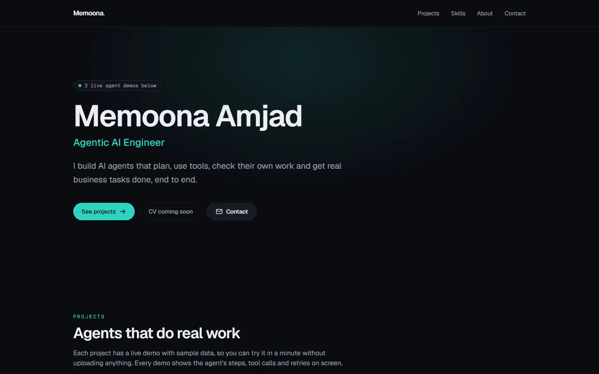
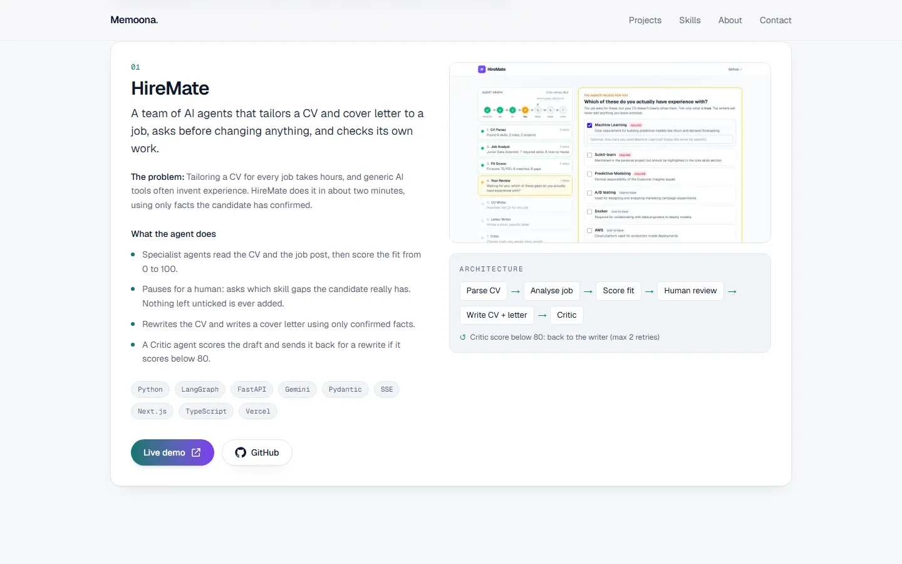
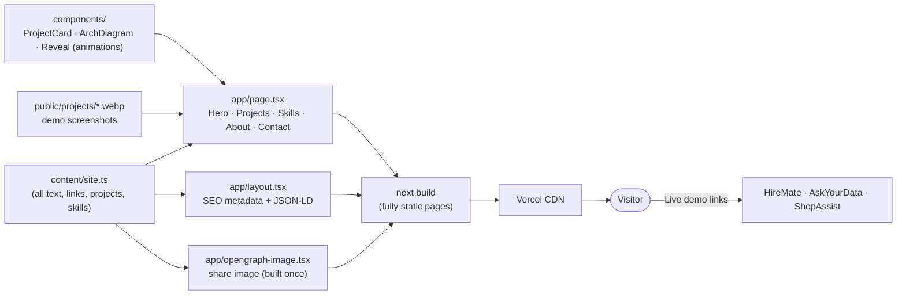

# Memoona Amjad · Agentic AI Engineer portfolio

**A one-page portfolio that shows, in 60 seconds, three working AI agent systems, each with a live demo you can try using sample data.**

**Live site: [memoona-amjad.vercel.app](https://memoona-amjad.vercel.app)**





<!-- TODO: replace with a short screen-recording GIF (docs/demo.gif) once recorded. -->

---

## The problem

Hiring managers and founders are busy and see a lot of "AI projects" that are only chatbots.
They need to see, quickly, that a candidate can build AI agents that **actually do work**,
and to try them without setting anything up.

## What the site does

1. **Intro:** a short first-person introduction, with links to the work, the CV and email.
2. **Selected work:** one entry per project (HireMate, AskYourData, ShopAssist) with the pitch, a screenshot of the agent at work, the business problem, what the agent does, how it's built, the tech used, and links to the **live demo** and the **code**.
3. **What I work with:** a simple list of skills grouped by Agent frameworks, LLMs, Backend, Frontend, Data and Cloud.
4. **About** and **Contact:** a short bio with background (education, research, roles), plus email, GitHub, LinkedIn and the CV.

The projects shown:

| Project | What it is | Live demo | Code |
|---|---|---|---|
| **HireMate** | Multi-agent CV and cover-letter tailoring with a human approval step and a self-checking critic | [hiremate-brown.vercel.app](https://hiremate-brown.vercel.app/) | [repo](https://github.com/Memoona-Amjad/hiremate) |
| **AskYourData** | AI data analyst that writes, runs and fixes its own Python to answer questions about a spreadsheet | [askyourdata-m.streamlit.app](https://askyourdata-m.streamlit.app/) | [repo](https://github.com/Memoona-Amjad/askyourdata) |
| **ShopAssist** | Customer-support agent that checks orders, starts returns and hands off to a human, using tools and RAG | [shopassist-one.vercel.app](https://shopassist-one.vercel.app/) | [repo](https://github.com/Memoona-Amjad/shopassist) |

## Architecture



**Design choices**
- **All content in one file** (`content/site.ts`). Updating text, links or projects never means touching components.
- **Fully static.** Every page, the share image, the sitemap and the icons are built ahead of time, so the site is fast and costs nothing to host.
- **No broken links.** If a project's `liveUrl` in `content/site.ts` is empty, the site says "Live demo coming soon" instead of linking nowhere.
- **Editorial, typography-led design.** Warm charcoal background, a serif display face (Instrument Serif) with Inter for body text, one amber accent, plain underlined text links, and thin rules instead of boxes and badges. All colours are design tokens in `app/globals.css`.
- **Light animations.** framer-motion loads only its small animation bundle (`LazyMotion`). The hero uses plain CSS, so the main text appears immediately. All motion turns off for people who ask their device for reduced motion.
- **Architecture diagrams drawn with HTML**, not a diagram library, to keep the page light.

Lighthouse (live site): **Desktop 100 / 100 / 100 / 100**, **Mobile 92–95 / 100 / 100 / 100** (Performance / Accessibility / Best Practices / SEO).

## Tech stack

| Area | Tools |
|---|---|
| Framework | Next.js 16 (App Router), React 19, TypeScript |
| Styling | Tailwind CSS 4, Instrument Serif + Inter via `next/font` |
| Animation | framer-motion (`LazyMotion` + `whileInView`), CSS keyframes |
| SEO | Next.js Metadata API, generated Open Graph image (`next/og`), sitemap, robots, JSON-LD |
| Hosting | Vercel (free Hobby plan) |

No API keys or secrets are needed. The site is static.

## Run locally (Windows)

You need **Node.js 20.9 or newer** and **Git**.

```powershell
git clone https://github.com/Memoona-Amjad/portfolio.git
cd portfolio
npm install
npm run dev
```

Open http://localhost:3000.

Other commands:

```powershell
npm run lint      # check code style
npm run build     # production build (what Vercel runs)
npm run start     # serve the production build at http://localhost:3000
```

### How to update the content

- **Text, links, projects, skills, bio:** edit `content/site.ts`.
- **CV:** replace `public\cv.pdf` with the new PDF (keep the same name).
- **Project screenshots or GIFs:** put the file in `public\projects\` and point the project's `media` to it.
  For a video use `{ kind: "video", src: "/projects/hiremate.mp4", alt: "..." }`.
- **Custom domain:** set `url` in `content/site.ts` (otherwise the Vercel address is detected automatically).

## Limitations and next steps

- **Screenshots, not videos.** Each project shows a still image. Short demo GIFs or videos would show the agents' steps in motion.
- **The live demos run on free tiers** (Gemini free tier, Streamlit Community Cloud, Vercel Hobby). AskYourData's Streamlit app may take a few seconds to wake up after a quiet period, and each demo limits runs per visitor per day.
- **English only**, single page.
- **Next steps:** demo GIFs, a custom domain, and a short write-up page per project if more depth is needed.
